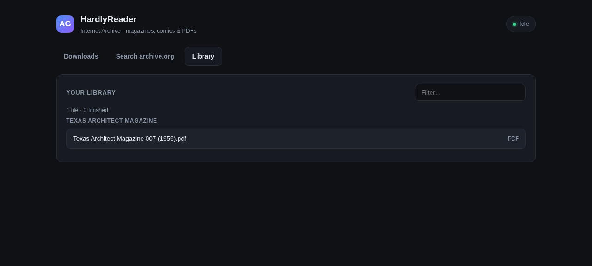
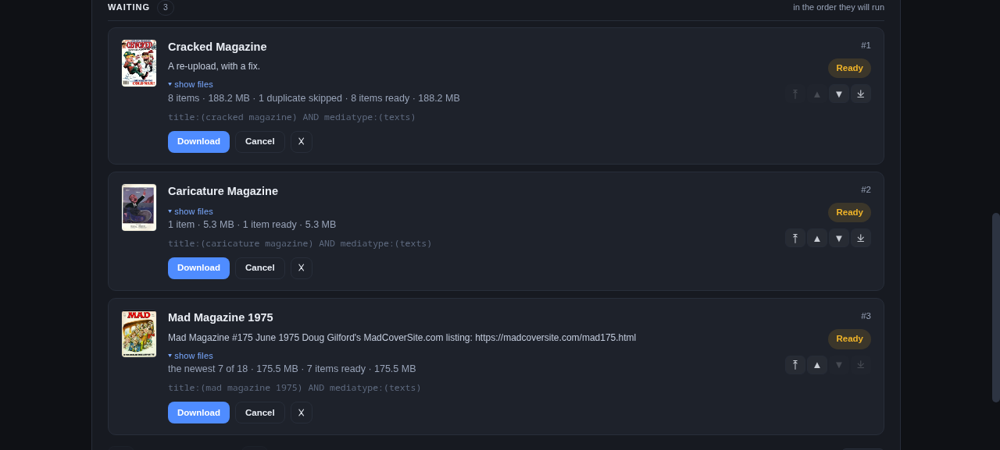
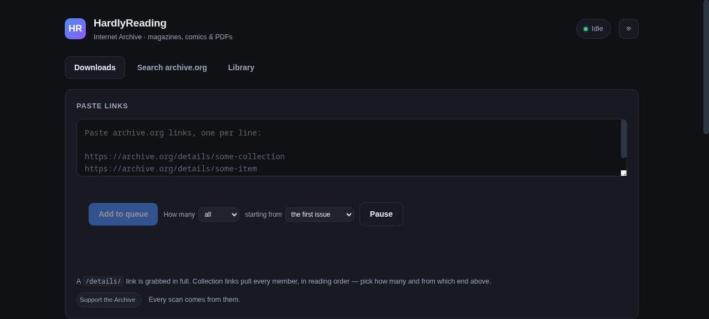
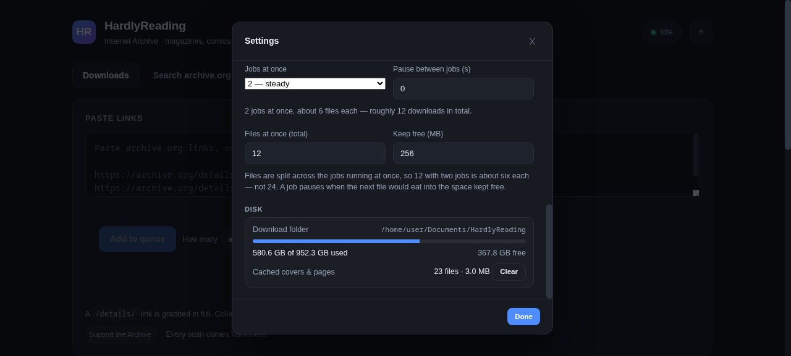
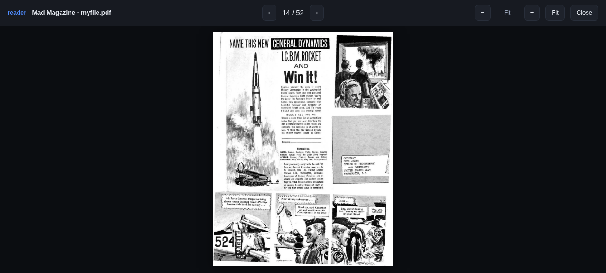
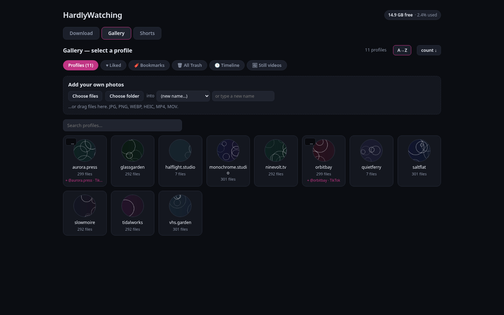
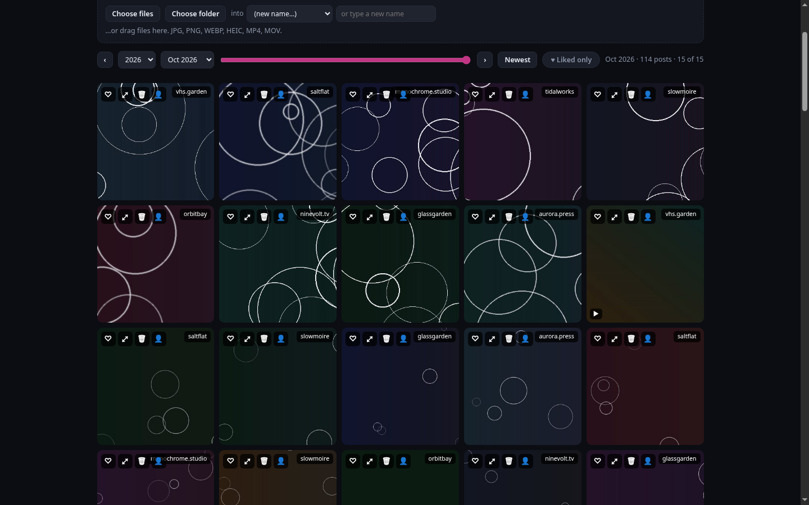
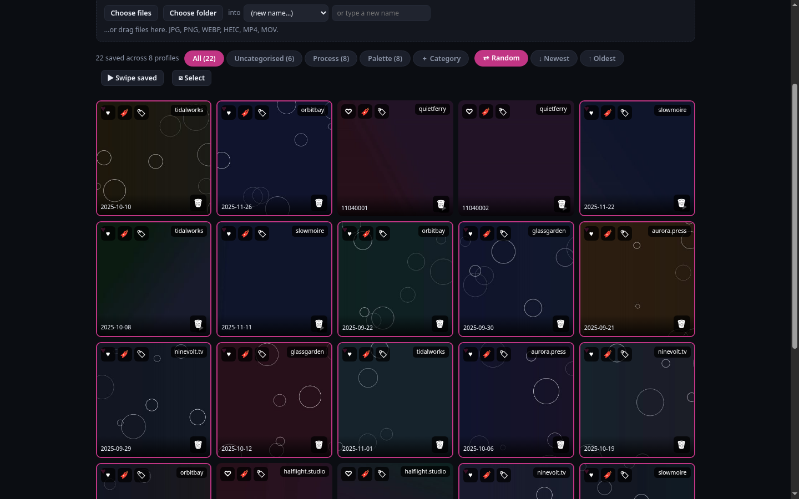
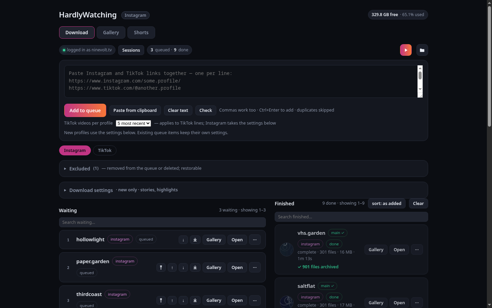
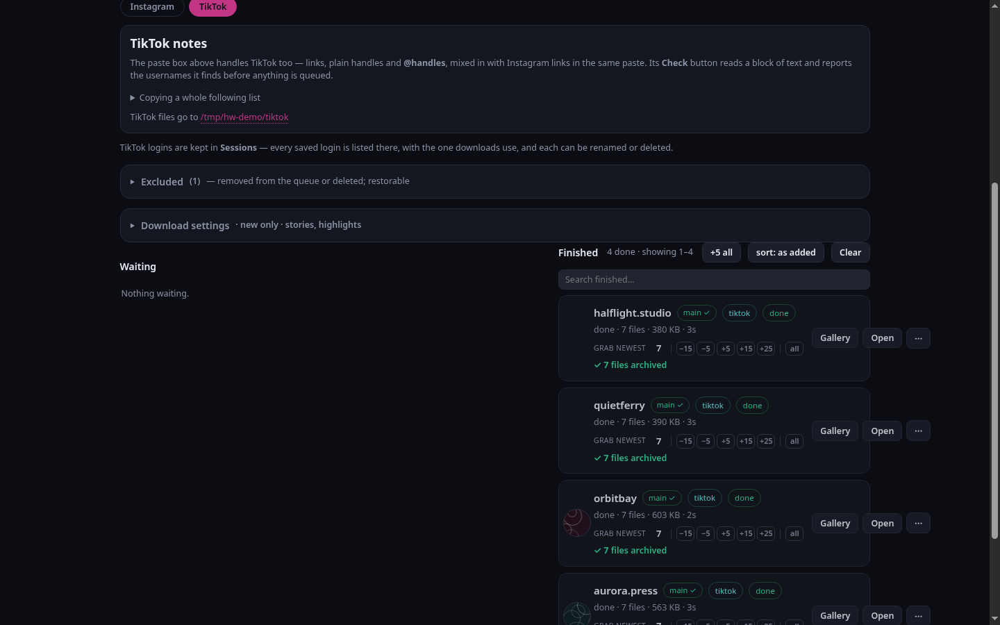

<h1 align="center">HardlyHoarding</h1>

<em>For your media hoarding needs. 
Local web UIs over stable, battle-tested downloaders. No accounts, no cloud, no telemetry.</em>

---

Two projects, each in its own public repo. Both are single-user web UIs that run on
your own machine and drive a mature CLI tool underneath — the frontends are
AI-generated, the download engines are not.

| Project | Hoards | About |
|---|---|---|
| **[HardlyReading](https://github.com/hardlysleeping/HardlyReading)** | Magazines, comics and PDFs from [Internet Archive](https://archive.org) | Paste a collection, item or search; downloads one good file per issue, verifies it, and names it for a comics server. Library with cover grid, filters and favourites, plus a CBZ/PDF reader that can also stream pages without downloading. |
| **[HardlyWatching](https://github.com/hardlysleeping/HardlyWatching)** | Instagram and TikTok profiles | Persistent queue for hundreds of profiles, paced with auto-resume after rate limits. Gallery, timeline, bookmarks with categories, and a phone-sized Shorts feed. |

---

## Backends

Neither app reimplements downloading. Each is a UI over a tool that already works.

**HardlyReading** — [Internet Archive](https://archive.org) for search, metadata and files, and
[aria2c](https://github.com/aria2/aria2) as the downloader.

**HardlyWatching** — [instaloader](https://instaloader.github.io/) for Instagram posts and profiles,
[yt-dlp](https://github.com/yt-dlp/yt-dlp) for video, and
[ffmpeg](https://ffmpeg.org/) for media handling.

---

## HardlyReading

**Grab whole collections from Internet Archive and read them.**

Paste a collection link, an item link, or search in-app. It resolves every member,
downloads one good file per issue — **CBZ/CBR first, then PDF** — and verifies each
against archive.org's checksum.

- **Best file per issue** — CBR → CBZ → image-PDF → text-PDF
- **Verified** — byte and MD5 check, because archive.org sometimes serves an error page with HTTP 200
- **Resumable** — restart mid-download and it continues; finished files are skipped
- **Retry with backoff** — 15m → 1h → 3h → 8h; genuinely missing items are marked unavailable
- **Komga-ready naming** — one folder per series, `<Series> NNN (Year).ext`, in reading order
- **Built-in reader** — CBZ and PDF, position saved server-side so it follows you between devices
- **Read without downloading** — stream a book's pages from archive.org, same reader, same saved place
- **A library worth browsing** — cover grid or list, filter chips, favourites, descriptions fetched from the item's own record
- **A queue that shows its work** — Downloading now / Paused / Needs attention / Waiting / Finished, with every file in flight listed
- **Reorder the queue** — push a job to the top, to the bottom, or one place up or down; the numbers are the run order
- **Take as many issues as you want** — pick a count and start from the first issue or the newest; the rest never enter the queue
- **Several jobs at once** — 1 to 4, with the file budget shared between them
- **Pauses instead of filling your disk** — if the next file will not fit, the job stops with the numbers and resumes when you free space
- **A disk panel that tells you where you stand** — used and free space, cache size, one button to clear it

| Library | Queue |
|---|---|
|  |  |

How many issues to take, and from which end:

Settings covers concurrency, the space kept free, and how full your disk is:

**Needs:** Python 3.8+ and `aria2c`. Start with `python run.py`.

→ **[Documentation and source](https://github.com/hardlysleeping/HardlyReading)**

---

## HardlyWatching

**Paste 200 profiles once and let them drain over days.**

A browser interface for instaloader and yt-dlp. Persistent queue, pacing,
auto-resume, and a gallery to browse what you kept.

- **Persistent queue** — survives reboots, drains one profile at a time
- **Auto-resume** — rate limits pause the queue instead of failing it
- **Two kinds of keeping** — a heart is *Liked*, a bookmark is *find this again*; bookmarks carry categories you name
- **Gallery and timeline** — browse by profile or by date, with filters and pick-several-then-act
- **Shorts** — a full-screen feed of reels and TikTok videos, installable to a phone home screen
- **Any folder is a profile** — phone uploads browse in the same grid
- **Recoverable removals** — deleting never loses anything; restore from the Removed list
- **Reels as a separate pass** — optionally queue reels as their own follow-up job

| Timeline | Bookmarks |
|---|---|
|  |  |

| Queue | TikTok | Shorts |
|---|---|---|
|  |  |  |

**Needs:** Python, `instaloader`, `yt-dlp` and `ffmpeg`.

> **Use at your own risk.** Downloading at scale can get your IP blocked, rate limited,
> or your account banned. Check the terms of any service you point these at.

→ **[Documentation and source](https://github.com/hardlysleeping/HardlyWatching)**

---

## Why two repos

One talks to a public archive with an open API and no login. The other drives two
CLI tools against services that rate limit and ban. Merging them would make each
install drag in dependencies it does not need, so they stay separate — this repo is
the index.

Neither project redistributes anything. What you download is your responsibility;
check the rights on anything you keep.

## License

PolyForm Noncommercial 1.0.0 — see [LICENSE](LICENSE). Each project keeps its own licence in its own repo.

## Support

